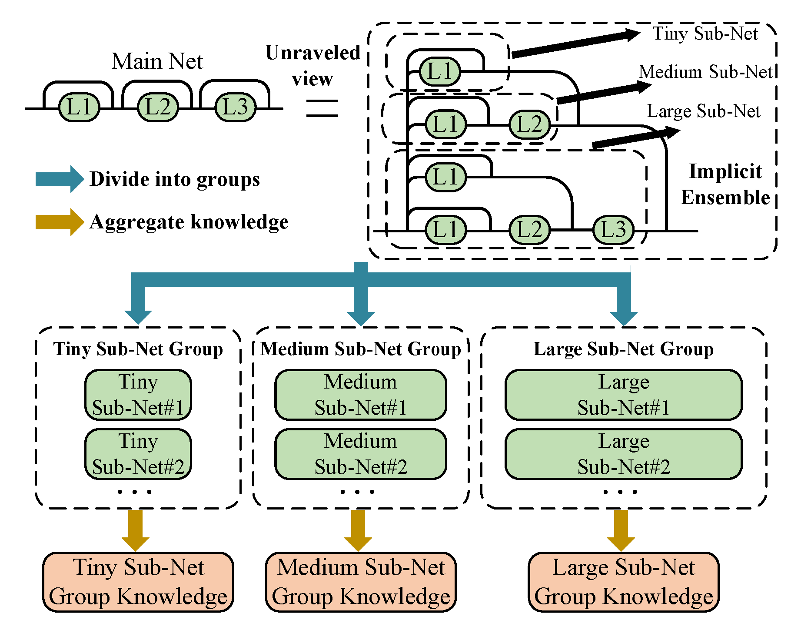
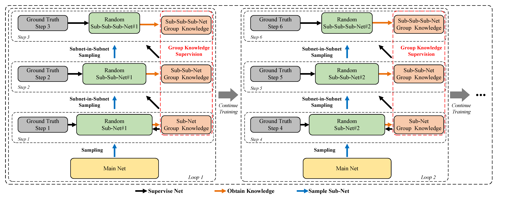
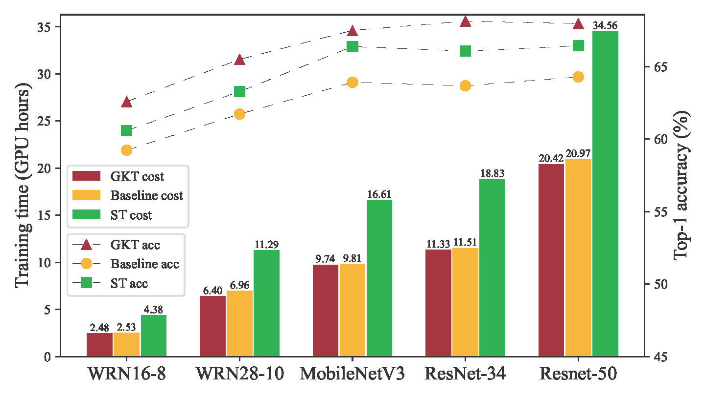

# GKT: Boosting Residual Networks with Group Knowledge (AAAI 2024)

This repository is the official **PyTorch** implementation of **[Boosting Residual Networks with Group Knowledge](https://arxiv.org/pdf/2308.13772)** (GKT). For easier comparison and adoption, we provide a **minimalist GKT recipe** that follows the core ideas of the paper while keeping the codebase minimal. For example, training ResNet-50 with GKT on CIFAR-100 fits in **under 10 GB** of GPU memory under the default configs in this repo, which is practical on widely available GPUs and convenient for self-distillation research.

**In brief:** we study residual networks as an **implicit ensemble of subnets** formed by skipping residual blocks. Prior subnet-based training often applies the same supervision to every capacity, which underuses the diverse knowledge different subnets produce during optimization. **Group Knowledge Training (GKT)** instead aggregates subnet outputs into structured group knowledge, stored in a **structure-wise memory bank** over training samples, and uses upper (larger-capacity) groups to supervise lower (smaller) groups via distillation. Because modern backbones are largely residual, GKT offers a **lightweight self-distillation** path that can outperform standard training without external teachers.

The remainder of this README covers **repository layout**, **supported models**, **installation**, **data**, **training**, **license**, and **citation**.

---

### Architecture



*Figure 1. Unraveled view of a residual network: multiple skip patterns induce a family of weight-sharing subnets, which GKT treats as a structured ensemble.*



*Figure 2. GKT training framework: subnet-in-subnet sampling, per-structure memory bank, and distillation from larger-capacity groups to smaller ones.*

**Architecture.** Residual networks admit many weight-sharing subnets by skipping blocks. GKT implicitly organizes subnets into hierarchical groups using a **subnet-in-subnet** sampling scheme: nested capacities are drawn along a Markov-style schedule over depth so that **larger subnets are sampled more often**. Each forward uses one active subnet; soft targets are written into a per-structure memory indexed by sample and group. After warm-up, smaller subnets add a KL distillation loss against the teacher distribution read from the next-larger group in the hierarchy, together with the usual cross-entropy on labels. This reduces the **supervision gap** between capacities and aligns predictions across the shared-weight family.

---

### Empirical performance



*Figure 3. Accuracy vs. training cost (time) on Tiny ImageNet: GKT improves the efficiency–performance trade-off compared with typical subnet training baselines (see the paper for full settings).*

**Results.** On **CIFAR-10/100** and **Tiny ImageNet**, and across multiple residual-style architectures, GKT achieves strong accuracy vs. training-efficiency trade-offs compared with typical subnet training and related methods, improving the **full model** while training only the shared-weight family. See the [paper](https://arxiv.org/pdf/2308.13772) for complete tables, ablations, and training details.

---

## Repository layout

| Path | Description |
|------|-------------|
| `gkt/model_bank/` | Backbone models and dynamic depth/width variants |
| `gkt/utils/` | Augmentations, learning-rate helpers, samplers, etc. |
| `configs/` | Training hyperparameters and defaults (YAML) |
| `scripts/` | Entry points: `train.py`, `process_config.py` |
| `assets/` | Figures for documentation |
| `runs/gkt/` | Logs and checkpoints (created at runtime; listed in `.gitignore`) |

---

## Supported models

`scripts/train.py` only builds the models below. The `--model` flag is restricted to this set (see `scripts/process_config.py`). Other architectures from the paper may be added in future releases.

| `--model` | Notes |
|-----------|--------|
| `resnet_20`, `resnet_32`, `resnet_56`, `resnet_110` | CIFAR-style ResNets |
| `resnet_34`, `resnet_50` | ImageNet-style ResNets (also used on CIFAR / Tiny ImageNet with adapted input) |
| `wide_resnet_16_8`, `wide_resnet_28_10` | WideResNet |
| `mobilenet_v3` | MobileNetV3 |
| `vit`, `vit12`, `vit24` | ViT variants (depth 9 / 12 / 24) |
| `swin` | Swin Transformer |

**Default YAML:** For CIFAR-style datasets, configs are chosen automatically (e.g. `config_cifar_big_multistep.yml` for `resnet_50`). On **Tiny ImageNet**, `vit12` and `vit24` share `config_tinyimagenet_vit.yml` because separate YAML files are not shipped. Override with `--configs path/to.yml` if needed.

---

## Installation

**Requirements:** **Python 3.10+** (see `pyproject.toml`). A **CUDA-capable GPU** is recommended.

1. **Create an environment** (optional):

   ```bash
   conda create -n gkt python=3.10
   conda activate gkt
   ```

2. **Install PyTorch** for your platform (pick the correct index URL / build on [pytorch.org](https://pytorch.org/)). Example (CUDA 11.8 wheels):

   ```bash
   pip install torch torchvision torchaudio --index-url https://download.pytorch.org/whl/cu118
   ```

3. **Install remaining dependencies** (does **not** reinstall PyTorch):

   ```bash
   pip install -r requirements.txt
   ```

4. **Install this repo in editable mode** (so `gkt` is importable from anywhere):

   ```bash
   pip install -e .
   ```

---

## Data

By default, data live under `data/` at the repository root (override with `--root`):

- **CIFAR-10 / CIFAR-100:** Downloaded automatically under `--root` on first use.
- **Tiny ImageNet:** Download [tiny-imagenet-200.zip](http://cs231n.stanford.edu/tiny-imagenet-200.zip), extract (e.g. to `data/tinyimagenet`), or point `--root` elsewhere.

Dataset paths and default config selection are defined in `scripts/process_config.py`.

---

## Training

Run from the **repository root** so `gkt` and `scripts` resolve correctly. Training implements **GKT** only (structure memory bank, subnet sampling, cross-structure distillation).

**CIFAR-100, ResNet-50:**

```bash
python scripts/train.py --GPU 0 --model resnet_50 --dataset cifar100 --exp exp_name --dimension d
```

**CIFAR-100, WideResNet-28-10:**

```bash
python scripts/train.py --GPU 0 --model wide_resnet_28_10 --dataset cifar100 --exp exp_name --dimension d
```

**Tiny ImageNet, WideResNet-28-10:**

```bash
python scripts/train.py --GPU 0 --model wide_resnet_28_10 --dataset tinyimagenet --exp exp_name --dimension d
```

Further hyperparameters live under `configs/*.yml`. Pass `--configs /path/to/config.yml` to use a specific file.

---

## License

This project is licensed under the **MIT License**. See the [`LICENSE`](LICENSE) file for the full text.

Portions of the code are adapted from **PyTorch Image Models (timm)** (e.g. `DropPath`, some transformer blocks); see file-level comments and [timm](https://github.com/huggingface/pytorch-image-models) for its license.

---

## Citation

If you find this project useful, please cite the paper:

```bibtex
@inproceedings{tang2024boosting,
  title={Boosting residual networks with group knowledge},
  author={Tang, Shengji and Ye, Peng and Li, Baopu and Lin, Weihao and Chen, Tao and He, Tong and Yu, Chong and Ouyang, Wanli},
  booktitle={Proceedings of the AAAI Conference on Artificial Intelligence},
  volume={38},
  number={6},
  pages={5162--5170},
  year={2024}
}
```
